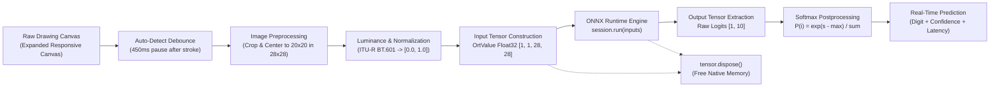

# Inside On-Device Machine Learning: ONNX and Flutter

An educational, production-ready reference application demonstrating how to integrate pretrained **ONNX (Open Neural Network Exchange)** machine learning models into **Flutter** for fast, private, on-device inference without cloud dependencies.

Using handwritten digit recognition (**MNIST**) as a practical example, this repository teaches the complete end-to-end engineering workflow: from model inspection to input tensor preparation, runtime execution, softmax post-processing, and native memory management.

---

## 📖 Key Architectural Concepts

### 1. What is ONNX?
**ONNX (Open Neural Network Exchange)** is an open format for representing machine learning models developed across various frameworks (PyTorch, TensorFlow, Scikit-Learn, JAX).
* **PyTorch / TensorFlow**: Used for training and exporting the model weights and computational graph.
* **ONNX (`.onnx`)**: A standardized protobuf representation describing the computational graph, operators, and tensor dimensions.
* **ONNX Runtime (`onnxruntime`)**: The cross-platform, high-performance engine that actually executes the model on the device (CPU, NNAPI on Android, CoreML on iOS).

> **Crucial Distinction**: Having an `.onnx` file does not mean Flutter can execute it directly. An inference engine like `flutter_onnxruntime` is required to run the computational graph natively.

---

## 🔄 The On-Device Inference Pipeline



---

## 🔬 Model Specifications (MNIST-12)

The pretrained model used is from the official [ONNX Model Zoo](https://github.com/onnx/models/tree/main/validated/vision/classification/mnist):

| Property | Expected Specification | Educational Note |
| :--- | :--- | :--- |
| **Model File** | `assets/models/mnist-12.onnx` | Bundled directly in Flutter assets (~26.1 KB) |
| **Input Name** | `Input3` | Queried dynamically via `session.inputNames.first` |
| **Input Shape** | `[1, 1, 28, 28]` | `[Batch Size, Channels, Height, Width]` |
| **Input Data Type**| `float32` | 784 normalized floating point values |
| **Background / Stroke** | Black background (`0.0`), White stroke (`1.0`) | Matches MNIST training distribution |
| **Output Name** | `Plus214_Output_0` | Queried dynamically via `session.outputNames.first` |
| **Output Shape** | `[1, 10]` | 10 raw logits representing digits `0` through `9` |
| **Post-processing**| Softmax with max-subtraction | Converts raw scores to normalized probabilities summing to `1.0` |

---

## 📐 End-to-End Implementation Walkthrough

### 1. Model Inspection with Netron
Before writing any Dart code, inspect the model using [Netron](https://netron.app/). Netron reveals:
* Exact tensor input and output names (`Input3`, `Plus214_Output_0`).
* Data types (`float32`).
* Exact tensor dimensions (`1 x 1 x 28 x 28`).

### 2. Loading the ONNX Model
```dart
final OnnxRuntime _runtime = OnnxRuntime();
OrtSession? _session;

Future<void> initialize() async {
  // Reuses session across predictions to avoid re-parsing overhead
  _session = await _runtime.createSessionFromAsset('assets/models/mnist-12.onnx');
}
```

### 3. Image Preprocessing & Tensor Construction
```dart
// 1. Resize to 28x28 pixels
final resized = img.copyResize(decoded, width: 28, height: 28);

// 2. Grayscale ITU-R BT.601 formula and normalize to 0.0 - 1.0
final pixels = <double>[];
for (var y = 0; y < 28; y++) {
  for (var x = 0; x < 28; x++) {
    final p = resized.getPixel(x, y);
    final grayscale = (0.299 * p.r + 0.587 * p.g + 0.114 * p.b) / 255.0;
    pixels.add(grayscale.toDouble());
  }
}

// 3. Construct Float32 OrtValue tensor
final inputTensor = await OrtValue.fromList(
  Float32List.fromList(pixels),
  [1, 1, 28, 28],
);
```

### 4. Running Inference & Releasing Native Memory
```dart
Map<String, OrtValue>? outputs;
try {
  outputs = await session.run({session.inputNames.first: inputTensor});
  final outputTensor = outputs[session.outputNames.first]!;
  final scores = (await outputTensor.asFlattenedList())
      .map((v) => (v as num).toDouble())
      .toList();

  // Softmax with numerical stability (subtract maxScore)
  final maxScore = scores.reduce(math.max);
  final exponentials = scores.map((s) => math.exp(s - maxScore)).toList();
  final sum = exponentials.reduce((a, b) => a + b);
  final probabilities = exponentials.map((v) => v / sum).toList();
  
  // ArgMax
  var bestIndex = 0;
  for (var i = 1; i < probabilities.length; i++) {
    if (probabilities[i] > probabilities[bestIndex]) bestIndex = i;
  }
} finally {
  // Free native C++ / JNI memory allocations
  await inputTensor.dispose();
  if (outputs != null) {
    for (final output in outputs.values) {
      await output.dispose();
    }
  }
}
```

---

## 🏛️ Codebase Architecture & Constraints

To keep the repository clean, maintainable, and beginner-friendly:
* **Simple State Management**: Powered by `provider` (`ChangeNotifierProvider`).
* **Stateless UI**: All views and widgets are `StatelessWidget`.
* **Clean Code Limit**: Every page and UI widget is strictly **under 200 lines**.
* **Separation of Concerns**: Business and ML logic reside exclusively in `controllers` and `providers`.

```
lib/
├── main.dart                                   # MultiProvider setup & Apple Dark theme (45 lines)
├── models/
│   ├── digit_prediction.dart                   # Data class: digit, confidence, probabilities, latencies
│   ├── drawing_stroke.dart                     # Model representing vector drawing strokes on canvas
│   └── model_metadata_info.dart                # Model specifications & tensor properties
├── services/
│   ├── mnist_classifier.dart                   # Core ONNX session, inference run, softmax, disposal
│   └── image_processing_service.dart           # Pure-Dart rasterization, bounding box crop, aspect centering
├── controllers/
│   └── drawing_controller.dart                 # Touch gestures, stroke coordinate buffer, undo/clear
├── providers/
│   └── digit_recognition_provider.dart         # Auto-detection debouncer, lifecycle states, inference
├── views/
│   └── home_page.dart                          # Minimalist Apple HIG main screen, stateless (105 lines)
└── widgets/
    ├── drawing_canvas_widget.dart              # Expanded responsive drawing canvas with auto-detect (167 lines)
    ├── prediction_result_card.dart             # Apple-style hero prediction card & latency badge (125 lines)
    ├── probabilities_chart.dart                # 10-class Softmax probability distribution bars (108 lines)
    ├── preprocessed_preview_card.dart          # 28x28 pixel grid showing tensor input [1, 1, 28, 28] (81 lines)
    ├── sample_digit_selector.dart              # Apple-style quick test chips 0-9 (62 lines)
    └── model_info_sheet.dart                   # Bottom sheet displaying ONNX model architecture (108 lines)
```

---

## 📱 Mobile Platform Considerations

### Android (ProGuard / R8 Rules)
When building for release with code shrinking enabled, native JNI bindings can be stripped. Ensure `android/app/proguard-rules.pro` includes:
```proguard
-keep class ai.onnxruntime.** { *; }
```
And verify `android/app/build.gradle.kts` references the rules:
```kotlin
buildTypes {
    release {
        proguardFiles(
            getDefaultProguardFile("proguard-android-optimize.txt"),
            "proguard-rules.pro"
        )
    }
}
```

### iOS (Deployment Target & Static Frameworks)
In `ios/Podfile`:
```ruby
platform :ios, '16.0'
```
ONNX Runtime on iOS requires iOS 16+ and static framework linkage.

---

## 🚀 Getting Started

### Prerequisites
* Flutter SDK `^3.13.2` or later
* Dart SDK `^3.13.2` or later

### Install Dependencies
```bash
flutter pub get
```

### Run Tests
```bash
flutter test
```

### Run the Application
```bash
# Run on macOS / iOS Simulator / Android Emulator / Connected Device
flutter run
```

---

## 📚 References & Further Reading
* [ONNX Model Zoo — MNIST](https://github.com/onnx/models/tree/main/validated/vision/classification/mnist)
* [ONNX Runtime Mobile Deployment Documentation](https://onnxruntime.ai/docs/tutorials/mobile/)
* [Netron Model Visualizer](https://netron.app/)
* [flutter_onnxruntime on pub.dev](https://pub.dev/packages/flutter_onnxruntime)
